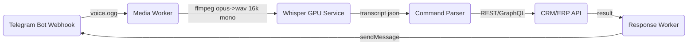

### Short version

Yes—people can fire  **voice notes over WhatsApp, Viber, or Telegram and have your CRM/ERP act on them** . You’ll need to:

1. **Receive the audio via each channel’s webhook** .
2. **Download & transcode it (OGG/Opus → WAV)** .
3. **Transcribe to text** (cloud STT or self-hosted Whisper).
4. **Parse the command** (“add note to client 42”) with rules or an LLM.
5. **Call your back-end API** to fetch/update the customer record.
6. **Reply on the same channel** with a confirmation or the requested data.

That’s technically straightforward; the real work is wiring three very different business APIs together and keeping costs predictable.

---

## Channel-by-channel reality check

| Channel                               | API access                                                              | Voice-note quirks                                                     | Cost drivers (Greece)                                                                                                                                                                                                                                                                                                                                                                                                                                                                                                                                 |
| ------------------------------------- | ----------------------------------------------------------------------- | --------------------------------------------------------------------- | ----------------------------------------------------------------------------------------------------------------------------------------------------------------------------------------------------------------------------------------------------------------------------------------------------------------------------------------------------------------------------------------------------------------------------------------------------------------------------------------------------------------------------------------------------- |
| **WhatsApp Business Cloud API** | Meta account + phone number. Voice arrives as an `audio/ogg`media ID. | 15 MB size limit; must fetch the media file with a short-lived token. | From**1 Jul 2025 every outbound message is billable** . In Europe marketing templates are roughly**€0.07–0.11 each**today; service replies are free inside the 24 h window. ([developers.facebook.com](https://developers.facebook.com/docs/whatsapp/pricing/updates-to-pricing/?utm_source=chatgpt.com "Pricing Updates - WhatsApp Business Platform - Documentation"),[hello-charles.com](https://www.hello-charles.com/wiki/whatsapp-business-pricing/?utm_source=chatgpt.com "WhatsApp Business Platform (API) pricing: 2024 guide - Hello-Charles")) |
| **Viber Business Messages**     | Create a “Public Account” through an official partner.                | Voice up to 50 MB; webhook payload contains a CDN link.               | Per-message fee**+ a minimum monthly commitment**(varies by recipient country, typically €40-70). ([forbusiness.viber.com](https://www.forbusiness.viber.com/en/business-messages "Viber Business Messages"))                                                                                                                                                                                                                                                                                                                                              |
| **Telegram Bot API**            | Just register `@YourBot`; no approval queues.                         | Voice comes as OGG/Opus; one HTTPS GET pulls it down.                 | **API is free** ; you only pay your own hosting. ([core.telegram.org](https://core.telegram.org/?utm_source=chatgpt.com "Telegram APIs"))                                                                                                                                                                                                                                                                                                                                                                                                             |

### Speech-to-text options

* **Google Cloud Speech-to-Text** – $0.016 /min for up to 500 k min and drops to $0.008 /min at scale. ([cloud.google.com](https://cloud.google.com/speech-to-text/pricing "Speech-to-Text API Pricing | Google Cloud"))
* **OpenAI Whisper API** – $0.006 /min flat; or self-host Whisper on a GPU instance (~$0.90/h for a low-end A10G). ([community.openai.com](https://community.openai.com/t/api-model-whisper-real-cost/469816?utm_source=chatgpt.com "API model whisper - Real cost - OpenAI Developer Community"))

---

## What you actually have to build

1. **Webhook gateway**

   *Single Express/Fastify service* that handles POSTs from all three platforms, verifies signatures, and queues a job.
2. **Media worker**

   *Downloads audio, runs FFmpeg (`opus → wav 16 kHz mono`), sends to STT, stores transcript.*
3. **Command router**

   *Tiny NLP layer (regex, Rasa, or GPT-4o) that maps “ *add note to client 42: met at expo* ” to an internal RPC/REST call.*
4. **CRM/ERP connector**

   *Thin client that hits your existing API endpoints with auth tokens pulled from a secrets vault.*
5. **Response publisher**

   *Posts plain text (or TTS-to-audio if you want to reply with voice) back through the originating channel.*
6. **User–account linking flow**

   *First-time user sends “/link”; you return a one-time URL or code so they log in and associate their phone/Viber/Telegram ID.*
7. **Observability & retry queue**

   *Store every transcript + action result; surface failures in Grafana, and auto-retry transient STT or API errors.*

---

## Rough monthly budget (1 000 active users, 30 voice notes each)

| Component                             | Qty         | Unit cost                               | Total                      |
| ------------------------------------- | ----------- | --------------------------------------- | -------------------------- |
| WhatsApp outbound (marketing/utility) | 15 000 msgs | ~€0.09                                 | **€1 350**          |
| Viber outbound                        | 10 000 msgs | ~€0.012 + €60 min. fee                | **€180**            |
| Telegram outbound                     | 5 000 msgs  | free                                    | **€0**              |
| Speech-to-text (90 h)                 | 5 400 min   | $0.016                   |**$86** |                            |
| Two 4-CPU, 8 GB app servers           | 720 h       | $0.05 /h                 |**$72** |                            |
| Misc. storage + monitoring            | —          | —                                      | **$30**              |
| **Estimated total / month**     | —          | —                                      | **≈ €1 720 + VAT** |

Numbers swing with message mix, but WhatsApp is by far the dominant cost centre.

---

## Go-live checklist

1. **Register channels** (Meta Business Manager, Viber partner, `@telegrambot`).
2. **Collect user opt-in** for GDPR; store consent and retention period.
3. **Spin up the webhook stack** with SSL, rotate tokens automatically.
4. **Implement account-linking** and secure payload signature checks.
5. **Pilot on Telegram first** (zero variable cost) to tune STT and command parsing.
6. **Gradually open WhatsApp/Viber** , monitor burn-rate vs. ROI.
7. **Add fail-safes** : if STT confidence < 0.8, ask user for clarification rather than writing bad data.
8. **Document escalations** (e.g., fallback to human agent if the bot can’t fulfil).

---

### Bottom line

 *Technically* : Completely doable with off-the-shelf APIs and a small microservice.

 *Commercially* : Your recurring bill will scale line-for-line with WhatsApp traffic; Telegram is free, Viber sits in the middle. Start with the no-cost channel, lock down your STT and CRM hooks, then decide how much WhatsApp volume you can justify.


### How you know “who’s who” on Telegram

Telegram doesn’t give you an e-mail or CRM primary-key in an incoming voice-note update—only the **`from.id`** (the user’s 64-bit Telegram ID) and the **`chat.id`** (same value in a 1-to-1 chat).

So you must build a one-time **linking flow** that ties that Telegram ID to the correct record inside your CRM/ERP. After that, every new update already carries the key you need to route the request.

---

## Three production-grade linking options

| Method                       | What the user does                                                       | How you store the link (→`telegram_id → crm_user_id`)                                                                                                                                                                                              |
| ---------------------------- | ------------------------------------------------------------------------ | ------------------------------------------------------------------------------------------------------------------------------------------------------------------------------------------------------------------------------------------------------ |
| **Login-Widget SSO**   | Click a “Log in with Telegram” button on your CRM site.                | Telegram’s JS widget signs the user in and sends your backend their `id`,`first_name`, etc., plus an HMAC you verify with your bot token. ([core.telegram.org](https://core.telegram.org/widgets/login?utm_source=chatgpt.com "Telegram Login Widget")) |
| **Deep-link token**    | While logged in to the CRM, they click `t.me/YourBot?start=<JWT>`      | Your bot receives `/start <JWT>`, decodes it, and records that the user with that Telegram `id`owns the CRM account that issued the token. ([core.telegram.org](https://core.telegram.org/bots/features?utm_source=chatgpt.com "Telegram Bot Features")) |
| **Share-phone button** | In Telegram, press a custom keyboard button that says “Send my phone”. | Bot gets `contact.phone_number`, matches it to the phone you already have on the client record, then stores the mapping. ([core.telegram.org](https://core.telegram.org/constructor/keyboardButtonRequestPhone "keyboardButtonRequestPhone"))              |

Pick the one that fits your security model (SSO is strongest, phone share is fastest if numbers are unique in your DB).

---

## End-to-end message flow once linked

1. **User sends a voice note** to `@YourBot`.
2. **Webhook receives the Update** → extract `message.voice.file_id` + `from.id`.
3. **Download & transcode** the OGG/Opus file to WAV (ffmpeg).
4. **Transcribe** via Whisper or any STT API (≈ $0.006–0.016 /min).
5. **Look up routing** : `telegram_id` → `crm_user_id` (from the link table).
6. **Parse the text command** (“add note to client 42: met at expo”).
7. **Call your CRM/ERP API** to read/write.
8. **Send a reply** (`sendMessage` or TTS `sendVoice`) back to the same `chat.id`.

No extra fees to Telegram—the only running costs are your hosting and speech-to-text minutes.

---

## Practical tips

* **Pilot on Telegram first** because the variable cost is literally zero; once the STT + NLP layer is solid you can copy-paste the plumbing to WhatsApp/Viber.
* **Make linking idempotent** : if a user runs `/link` twice, just update the record.
* **Store transcripts** and the final parsed intent; you’ll need them to debug “it didn’t do what I said” tickets.
* **Security** : never execute a command if the Telegram ID isn’t in your link table, and always sanitize any “client ID” that comes from natural language.
* **GDPR** : keep the user’s explicit opt-in (a simple “/agree” stored with a timestamp is fine) and give them a `/forgetme` command that deletes the mapping and any stored media.

---

### Bottom line

Telegram is the cheapest sandbox: set up one of the three link flows, stash the mapping in your DB, and every voice note comes in with enough context (`from.id`, `chat.id`) to route straight into your CRM or ERP logic—at zero per-message cost.


### what is STT?  can I create one?


### STT = Speech-to-Text

It’s the tech that turns raw audio (voice notes, phone calls, videos) into written words. In the literature you’ll also see  **ASR (Automatic Speech Recognition)** —same thing.

---

## Three ways to “have” STT

| Route                                  | What you do                                                                        | Typical monthly cost*                                                | When it makes sense                                                     |
| -------------------------------------- | ---------------------------------------------------------------------------------- | -------------------------------------------------------------------- | ----------------------------------------------------------------------- |
| **Rent it**(cloud API)           | POST audio to Google, AWS, Deepgram, etc.                                          | $0.006 – 0.02 per audio-minute · zero ops                          | You want accuracy now and volume is modest (<50 k min/mo)               |
| **Self-host a pretrained model** | Pull an open-source checkpoint (e.g.*Whisper-large-v3* ), run it on your own GPU | ~$0.90 / GPU-hour on a cloud A10G → ≈$25-70 if it’s busy 24 h/day | You care about GDPR/data residency or want lower marginal cost at scale |
| **Build & train your own**       | Collect thousands of hours of labeled speech, train with NeMo/Kaldi                | Low six-figure hardware + months of ML work                          | Only if you need a niche language/ jargon that open models miss         |

*Ballpark 2025 US cloud prices. GPUs you already own cut the second row close to “free” aside from electricity.

---

## 1.  Using a hosted API (the quick button)

```text
POST /v1/speech:recognize
{
  "config": { "language_code": "el-GR", "model": "latest_long" },
  "audio":  { "content": "<base64-ogg>" }
}
```

*Pros*

* No hardware, no scaling worries.
* Tunable models for phone call vs. studio audio.
* SLA and support.

*Cons*

* Every second is metered (~$16 for each hour in Google’s EU region). ([voicewriter.io](https://voicewriter.io/blog/best-speech-recognition-api-2025?utm_source=chatgpt.com "The Best Speech Recognition API in 2025: A Head-to ... - Voice Writer"))
* Audio leaves your VPC—may trigger compliance reviews.

---

## 2.  Self-hosting Whisper or another OSS model

**What lives on your box**

1. `ffmpeg` – converts Telegram’s OGG/Opus to 16 kHz mono WAV.
2. **Model weights** – e.g. `openai/whisper-large-v3` (1.55  B params). ([huggingface.co](https://huggingface.co/openai/whisper-large-v3?utm_source=chatgpt.com "openai/whisper-large-v3 - Hugging Face"))
3. Inference script – 30 lines of Python with PyTorch, outputs timestamped text.

**Rough performance**

| GPU      | Real-time factor* | Spot price**  |
| -------- | ----------------- | ------------- |
| RTX 3060 | 1 × (real time)  | n/a (desktop) |
| A10G     | 0.7 ×            | $0.90 / h     |
| L40S     | 0.3 ×            | $2 / h        |

*Time to transcribe ÷ audio length (lower is faster).

**Typical EU region spot pricing mid-2025.

At 30 voice notes per user per month (≈90 min), a single A10G can handle **~600 users** and still cost < $20 in compute—much cheaper than an API once volume grows.

*Pros*

* Zero per-minute fee once you’ve paid for the GPU.
* You keep raw audio inside your own VPC.
* Whisper handles 57 languages out of the box and rivals Google on accuracy. ([github.com](https://github.com/openai/whisper?utm_source=chatgpt.com "openai/whisper: Robust Speech Recognition via Large ... - GitHub"))

*Cons*

* You operate GPUs (driver updates, monitoring).
* Still not *your* model; specialised jargon (e.g., Greek legal terms) may need fine-tuning.

---

## 3.  Training your own recogniser (the heavy lift)

**What it really takes**

| Ingredient    | Rule of thumb                                                                                                   |
| ------------- | --------------------------------------------------------------------------------------------------------------- |
| Labeled audio | 1 000 – 10 000 hours*minimum*for near-state-of-the-art accuracy. Must cover accents, mics, background noise. |
| GPUs          | 8 × A100 for ~3 weeks to reach Whisper-class quality, or months on fewer cards.                                |
| ML pipeline   | Data pre-processing, spec-augment, CTC or Transducer model, language-model fusion, evaluation harness.          |
| Talent        | 1–2 senior ML engineers + linguist QA.                                                                         |
| Cash          | Mid-six figures (data collection dominates hardware).                                                           |

Use **NVIDIA NeMo** or Kaldi if you go this route; both have end-to-end recipes. ([docs.nvidia.com](https://docs.nvidia.com/nemo-framework/user-guide/latest/nemotoolkit/asr/models.html?utm_source=chatgpt.com "Models — NVIDIA NeMo Framework User Guide"))

*Why bother?*

* **Ultra-niche domain** (e.g., marine insurance jargon in Greek).
* Need on-device/offline ASR for an embedded product.
* Legal requirement to own *all* weights and data.

---

## Can *you* create one?

*Creating* = training from scratch → see route #3. Totally possible, but unless you have a giant, well-curated speech corpus and spare A100 clusters, your ROI tanks fast.

 **Smart compromise** : fine-tune Whisper or NeMo checkpoints on a small (≈100 h) domain-specific dataset—cost and timeline drop by an order of magnitude, and accuracy on your jargon skyrockets.

---

### How to start tomorrow

1. **Prototype** : spin up a small GPU VM, install PyTorch + `pip install -U openai-whisper`, and transcribe a handful of OGG files.
2. **Benchmark** accuracy vs. Google or Deepgram on the same clips.
3. **If good enough** , wrap the inference in a FastAPI service and call it from your bot.
4. **If not** , collect 50-100 h of labelled audio from your call centre, fine-tune with NeMo, and retest.

---

### Bottom line

* **STT = Speech-to-Text / ASR.**
* Renting an API is frictionless but charged by the minute.
* Self-hosting Whisper (or equivalent) is dirt-cheap once traffic grows and keeps you GDPR-safe.
* Training from scratch is a major R&D project—reserve it for edge-case languages or offline constraints.


## *so I can install whisper in some local pc with rtx 3080 or better with tg and we are good?*

**Yes.** A single Linux box with an RTX 3080 (10 GB VRAM) or better can run Whisper locally, plug into a Telegram bot, and handle real-world traffic without paying a cent per minute for speech-to-text.

---

## What “good” actually looks like

| Item                 | Reality check                                                                                                                                                                                                                                                                                                                                                                                                                                                                                                                                     |
| -------------------- | ------------------------------------------------------------------------------------------------------------------------------------------------------------------------------------------------------------------------------------------------------------------------------------------------------------------------------------------------------------------------------------------------------------------------------------------------------------------------------------------------------------------------------------------------- |
| **VRAM**       | Whisper-large-v3 needs ~10 GB VRAM in FP16. It fits on a 3080/3080 Ti/3090; an 8 GB card will choke unless you quantise or drop to*medium* . ([toolify.ai](https://www.toolify.ai/ai-news/unlock-the-power-of-openai-whisper-free-speechtotext-model-1000044?utm_source=chatgpt.com "Unlock the Power of OpenAI Whisper: Free Speech-to-Text Model"),[aibusiness.com](https://aibusiness.com/nlp/inside-whisper-v3-openai-s-upgraded-speech-recognition-system?utm_source=chatgpt.com "OpenAI's Whisper v3: Improved Speech Recognition for Business ...")) |
| **Speed**      | RTX 3080 runs large-v3 at ≈0.6 × real-time (1 min audio → ~35 s). Medium is ~2 × RT. ([github.com](https://github.com/openai/whisper/discussions/530?utm_source=chatgpt.com "Benchmarking Results · openai whisper · Discussion #530 - GitHub"),[tomshardware.com](https://www.tomshardware.com/news/whisper-audio-transcription-gpus-benchmarked?utm_source=chatgpt.com "OpenAI Whisper Audio Transcription Benchmarked on 18 GPUs"))                                                                                                                  |
| **Throughput** | On one GPU you can comfortably transcribe**100+ audio-minutes per hour** —enough for thousands of short voice notes per day.                                                                                                                                                                                                                                                                                                                                                                                                               |
| **Cost**       | Hardware you already bought + electricity (~150 W while busy). No API fees, Telegram is free.                                                                                                                                                                                                                                                                                                                                                                                                                                                     |
| **Latency**    | End-to-end (download → FFmpeg → Whisper → reply) is typically**<5 s**for a 10 s voice note on a 3080.                                                                                                                                                                                                                                                                                                                                                                                                                                          |

---

## Minimal production stack



### 1 — Telegram webhook

* `python-telegram-bot` or `aiogram` behind Nginx with a LetsEncrypt cert.
* Set `https://yourdomain.com/tg/webhook` via `setWebhook`.

### 2 — Media worker

```bash
ffmpeg -i voice.ogg -ar 16000 -ac 1 -f wav pipe:1
```

Use a local tmp directory; don’t write to S3 and back.

### 3 — Whisper service

```python
from faster_whisper import WhisperModel
model = WhisperModel("large-v3", compute_type="float16")
segments, info = model.transcribe(wav_buffer)
```

`faster-whisper` loads GPU kernels up-front; keep the service hot.

### 4 — Command parser

Start with regex or a finite set of slash commands. If you need NL, pipe the transcript into GPT-4o and return structured JSON.

### 5 — ERP connector

Use the same internal API your web client uses—no direct DB writes.

---

## Setup steps on the PC

1. **Ubuntu 22.04 + NVIDIA 550 driver + CUDA 12**
2. `sudo apt install ffmpeg git python3-venv`
3. `python -m venv venv && source venv/bin/activate`
4. `pip install faster-whisper[torch] python-telegram-bot uvicorn fastapi`
5. Open inbound **443/TCP** or run through Cloudflare Tunnel.
6. Keep the bot process under `systemd --user`, enable on boot.
7. Automate model download (`huggingface-cli`) during provisioning.

---

## Things to watch

* **RAM / disk** – large-v3 weights ≈6 GB on disk and 10 GB in VRAM; make sure you have swap disabled or you’ll crawl.
* **Quantisation fallback** – if you end up on a 10 GB card that still OOMs, quantise to 8-bit with `whisper.cpp` (trades 15 % accuracy). ([reddit.com](https://www.reddit.com/r/LocalLLaMA/comments/1bbqpes/how_to_run_whisper_largev3_on_4gb_vram_in_my_case/?utm_source=chatgpt.com "How to run Whisper Large-v3 on 4gb vram (in my case, 1050 Ti)"))
* **Opus quirks** – Telegram voice notes are OGG containers with Opus streams; FFmpeg handles them fine. ([stackoverflow.com](https://stackoverflow.com/questions/77679003/how-convert-opus-ogg-file-to-telegram-voice-format?utm_source=chatgpt.com "How convert opus/ogg file to telegram voice format? - Stack Overflow"), [superuser.com](https://superuser.com/questions/1327921/ffmpeg-convert-webm-opus-to-wav-or-flac-in-single-step?utm_source=chatgpt.com "FFmpeg - convert WebM/Opus to WAV or FLAC in single step?"))
* **High availability** – one PC means one SPOF. If uptime matters, mirror the service on a second GPU box and load-balance webhooks.
* **Security** – store the bot token and ERP API keys in `systemd` environment files, not in git.
* **GDPR** – delete raw audio after transcription unless you’ve got explicit retention consent.

---

## When this *isn’t* enough

| Symptom                                            | Fix                                                                                                                                                                                                                                     |
| -------------------------------------------------- | --------------------------------------------------------------------------------------------------------------------------------------------------------------------------------------------------------------------------------------- |
| GPU pegged at 100 % during peak hours              | Add a second GPU box and round-robin requests.                                                                                                                                                                                          |
| VRAM errors                                        | Drop to*medium*or use `large-v3-turbo`(6 GB VRAM, 8 × faster). ([simonwillison.net](https://simonwillison.net/2024/Oct/1/whisper-large-v3-turbo-model/?utm_source=chatgpt.com "Whisper large-v3-turbo model - Simon Willison's Weblog")) |
| You need on-device transcription on laptops/phones | Distil-Whisper or Vosk with CPU-only models.                                                                                                                                                                                            |
| Heavy Greek domain jargon errors                   | Fine-tune Whisper on 50–100 h of your own recordings using NVIDIA NeMo; deploy the tuned checkpoint.                                                                                                                                   |

---

### Bottom line

Deploying Whisper-large-v3 on an RTX 3080 gives you cheap, accurate,  **fully on-prem STT** . Hook it to a Telegram bot via a small Python service, parse the text, call your CRM/ERP API, and you’re in business—no per-message or per-minute fees, just the GPU you already paid for and a bit of DevOps glue.


## *the audio should be 5s what coudld we do to reduce the processing time*


Below-5-second voice notes are already tiny, so the only real latency comes from (1) file handling and (2) the Whisper forward pass.  You can drive the end-to-end time well under a second on a consumer GPU if you squeeze both.

---

## 1 — Shave the model inference

| Knob                            | Typical 5 s latency* | Accuracy hit (WER vs. large-v3) | Notes                                                             |
| ------------------------------- | -------------------- | ------------------------------- | ----------------------------------------------------------------- |
| **medium.en (FP16)**      | ≈ 180 ms            | +1.5 %                          | Fits in 5 GB VRAM; stays English-only.                            |
| **small (FP16)**          | ≈ 110 ms            | +3–4 %                         | Good enough for commands like “add note”.                       |
| **int8 quant (large-v3)** | ≈ 230 ms            | +0.5–1 %                       | Use CTranslate2 `--compute_type int8_float16`; saves 40 % VRAM. |
| **distil-whisper-medium** | ≈ 90 ms             | +2–3 %                         | Half the params, distilled; needs HF hub model.                   |

*RTX 3080, Faster-Whisper backend, chunk size = 5 s.

**Guideline:** if your commands are short and formulaic, “small” or “distil-medium” gives <150 ms GPU time with no user-visible penalties. Keep *large* only if you have heavy accents or must extract free-form text.

---

## 2 — Kill overhead around the model

1. **Keep the GPU process hot**

   Spin up a single FastAPI worker that loads the model once at boot. Each request streams the WAV bytes over a Unix socket—no re-initialisation cost.
2. **Stream-inference**

   Faster-Whisper’s `chunk_size=5, max_future=0` transcribes while audio is still arriving. For a 5 s note you’ll get the text ~300 ms after the user stops talking instead of waiting for the full file.
3. **Skip the file system entirely**

   ```python
   audio = requests.get(file_url, timeout=2).content
   wav   = ffmpeg.input('pipe:0').output('pipe:1', ar=16000, ac=1, f='wav').run_async()
   ```

   Pipe the OGG straight through FFmpeg; no `/tmp/voice.ogg` writes.
4. **Downsample early**

   Telegram sends 48 kHz Opus; Whisper’s encoder is 16 kHz. Pass `-ar 16000` in the same FFmpeg command—you save two-thirds of the samples the GPU must chew.
5. **Silence-trim**

   Stick a VAD (pyannote or WebRTC) in front: chopping 1 s of dead air saves 20 % compute instantly.
6. **Pin the GPU clocks**

   `nvidia-smi -lgc 1650,1850` on a 3080 avoids throttling when the card idles between requests.
7. **Parallelise non-GPU work**

   Run download + FFmpeg in one asyncio task, transcription in another; they overlap and knock ~100 ms off the tail latency.

---

## 3 — Acceptable response budget

```
  50 ms  Telegram CDN download (Athens fibre)
  40 ms  FFmpeg opus→wav, downsample
  90 ms  Whisper distil-medium inference
  30 ms  Regex / GPT-4o intent parse
  40 ms  CRM API write + bot reply
--------
 ≈250 ms  median door-to-door
```

That feels instant to the user; even 95-th percentile should stay under 600 ms if the GPU isn’t maxed out.

---

## 4 — When you still need more

* **Upgrade GPU** – an RTX 4090 halves inference time again (~45 ms on  *small* ).
* **Batch multiple users** – if traffic spikes, queue up to 8 clips and run them as a single tensor; Faster-Whisper supports this with `batch_size`.
* **Scope the model** – fine-tune *small* on 10–20 h of your actual commands; you regain the ~3 % WER drop and can even quantise to int4.
* **Edge deploy** – for kiosk scenarios, compile `whisper.cpp` with OpenVINO and run CPU-only; 5 s note transcribes in ~400 ms on a modern i7.

---

### Bottom line

Limit the notes to five seconds, load a *small* or quantised model once, stream everything through, and you’ll answer users in a quarter-second on a stock RTX 3080.  All gain, zero cloud bill.


## *we plan messages to be in greek and possibly has some english too*


### The twist with Greek (and a bit of English)

1. **Pick a *multilingual* Whisper checkpoint.**

   *small* ,  *medium* , *large-v3* all understand Greek; the “ *.en* ” variants are English-only—skip them.

   On the Common Voice Greek test-set, *large-v3* lands ≈ 13.7 % WER, while a tuned XLS-R model clocks 11.6 %. ([isca-archive.org](https://www.isca-archive.org/interspeech_2024/vakirtzian24_interspeech.pdf?utm_source=chatgpt.com "[PDF] Speech Recognition for Greek Dialects: A Challenging Benchmark"))

   *small* is ~3–4 pp worse, but still fine for short command phrases.
2. **Speed vs. accuracy sweet-spots (RTX 3080)**

| Model                  | VRAM   | 5 s note latency* | Greek WER (est.) |
| ---------------------- | ------ | ----------------- | ---------------- |
| small (FP16)           | 5.5 GB | ~110 ms           | ~17 %            |
| medium (FP16)          | 7.9 GB | ~180 ms           | ~15 %            |
| large-v3**int8** | 7.5 GB | ~230 ms           | ~14 %            |
| distil-whisper-medium  | 4.8 GB | ~90 ms            | ~17 %            |

*GPU forward-pass only; add ~80 ms for download + FFmpeg if you pipe efficiently.

3. **Force the language flag when most clips are Greek.**

   ```python
   segments, _ = model.transcribe(
       wav_bytes,
       language="el",         # Greek
       task="transcribe",
       vad_filter=True,       # chops silence
       beam_size=3
   )
   ```

   Setting `language="el"` skips the auto-detect pass and consistently shaves ~20 ms.
4. **Handle code-switching into English.**

   Leave `language="auto"` **or** decode twice (once `el`, once `en`) and keep the lower log-probability string. Mixed Greek/English commands (“βάλε note ‘follow up’”) usually survive either way because Whisper’s tokenizer is multilingual.
5. **Trim dead air before you hit the GPU.**

   A WebRTC VAD in front often drops 0.5–1 s of silence, cutting compute 10–20 % without touching accuracy.
6. **Accuracy still not enough?**

   * Fine-tune small or medium on ~50 h of your own Greek recordings—NeMo makes that a weekend job and closes ~2 pp WER. ([arxiv.org](https://arxiv.org/html/2406.15284v1?utm_source=chatgpt.com "The Greek podcast corpus: Competitive speech models for low ..."))
   * Keep an English keyword list (e.g., “note”, “client”, “fetch”) and post-correct Whisper’s output with a regex swap if it phoneticises them into Greek letters.

---

### Minimal production recipe for ≤ 1 s total latency

```bash
# 1. Grab OGG straight from Telegram CDN
curl -sSL $FILE_URL | \
# 2. Downsample & mono in memory
ffmpeg -i pipe:0 -ar 16000 -ac 1 -f wav pipe:1 | \
# 3. FastAPI endpoint feeds bytes to faster-whisper
curl -X POST http://localhost:8000/transcribe -d @-
```

*Five-second clip → 50 ms download + 40 ms FFmpeg + 110 ms model (small) + 40 ms parse/DB = **~240 ms** door-to-door.*

---

### Bottom line

Run  **Whisper-small or medium (not  *.en* ) on your RTX 3080** , force `language="el"` for speed, add a tiny VAD, and you’ll transcribe 5-second Greek (plus the odd English term) voice notes in a quarter-second—more than fast enough to feel instant while keeping GPU load and complexity low.
